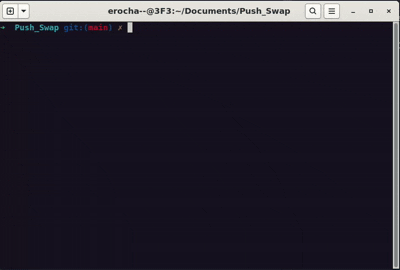

*This project has been created as part
of the 42 curriculum by erocha--*

# Push_swap

## Mandatory part

### *Description*

Push_swap consists of sorting data on a stack, using a limited number of instructions and performing as few moves as possible. The difficulty lies in manipulating two data structures (stacks A and B) and choosing an optimized algorithm that meets the project's performance criteria.

Push_swap consiste à trier des données sur une pile, avec un set d'instructions limité, en utilisant le moins de mouvements possible.
Le défi repose sur la manipulation de deux structures de données (les piles A et B) et sur le choix d'un algorithme optimisé pour répondre aux critères de performance du sujet.

### *Instructions*

The required part must be compiled with `make`, then you just need to run the executable (`./push_swap`) with the arguments; there must be at least one argument that can only contain integers, otherwise the program will return "Error".

Il faut compiler la partie obligatoire avec `make`, ensuite il suffira de lancer l'exécutable (`./push_swap`) avec les arguments, il doit y avoir au moins un argument qui peut contenir uniquement des entiers sinon le programme enverra "Error"

### *Resources*

I used Google Gemini AI for the documentation of linked lists and the explanation of the Turkish algorithm.

J'ai utilisé l'IA de Google Gemini pour la documentation des listes chaînées et l'explication de l'algorithme turc.

## Bonus part

### *Description*

The goal of the bonus is to create a program capable of checking if the list of instructions entered by the user actually sorts the stack.

Le but du bonus est de créer un programme capable de vérifier si la liste d'instructions entrer par l'utilisateur trie effectivement la pile.

## Instructions

You need to compile the bonus with `make bonus`, then simply run the executable (`./checker`) with the arguments. There must be at least one argument that can only contain integers; otherwise, the program will return an "Error". The instructions entered must have the same name as a possible move (Example: "pa" or "sb"). To complete your list of instructions, simply press Ctrl + d.

Il faut compiler le bonus avec `make bonus`, ensuite il suffira de lancer l'exécutable (`./checker`) avec les arguments, il doit y avoir au moins un argument qui peut contenir uniquement des entiers sinon le programme enverra "Error". Les instructions rentrer doivent avoir le meme nom qu'un mouvements possible (Exemple: "pa" ou "sb"), pour terminer votre liste d'instructions il suffit d'appuyer sur Ctrl + d.

# Extras

## Technical Choices

### Architectural choice

I chose to use the double linked list architecture because it was more computationally optimized and easier to manipulate than arrays.

J'ai choisi d'utiliser l'architecture de la liste doublement chaînée car elle était plus optimisée en termes de calcul et plus facile à manipuler que les tableaux.

### Algorithm choice

I chose the Turkish algorithm for its optimization and because it fits within the project's pricing structure.

J'ai choisi l'algorithme turc pour son optimisation et car il rentrer dans le bareme du projet.